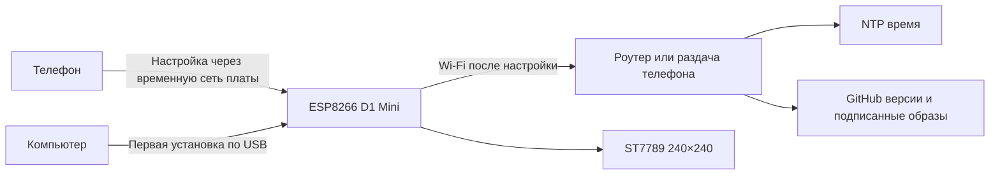

# Архитектура WeekClock

Первая установка выполняется по USB. После неё ESP8266 самостоятельно получает время через NTP, рассчитывает учебную неделю и проверяет новые подписанные прошивки в публичном GitHub. Для обновлений плате не нужен GitHub-токен.

## Настройка без старого Wi-Fi

При отсутствии сохранённой сети плата открывает защищённую точку настройки. Если сеть сохранена, сначала пытается подключиться; через 60 секунд без подключения открывает точку настройки на пять минут. Автоматическое открытие выполняется один раз за запуск. В любой момент её можно открыть командой `wifi` через USB Serial.

Имя точки имеет вид `WeekClock-…`, случайный пароль создаётся при каждом открытии. Экран и Serial показывают эти данные и адрес `192.168.4.1`. Домашний пароль не выводится в журнал. После сохранения новых данных портал закрывается, а плата повторяет подключение. Неуспешное подключение не стирает введённые параметры: это необходимо, когда раздача телефона ещё выключена.

С одним телефоном настройка и раздача идут по очереди. Сначала телефон подключается к WeekClock, пользователь вручную вводит имя и пароль **будущей** точки доступа телефона и сохраняет их. Затем отключается от WeekClock и включает свою раздачу в режиме 2,4 ГГц. Плата подключается сама. При смене владельца прежний пароль не нужен.

Обычная USB-клавиатура через переходник к D1 Mini не подключается: для неё нужен отдельный USB-host. В этой версии ввод выполняется через браузер телефона.

## Часы и календарь

До первой NTP-синхронизации показывается ожидание, а не выдуманная дата. Часовой пояс по умолчанию — Москва. После синхронизации часы идут локально, даже если выключить раздачу. После отключения питания время нужно получить снова. Давность синхронизации отображается отдельно от статуса Wi-Fi.

| Период включительно | Отсчёт |
| --- | --- |
| 1 сентября — 9 февраля | Семестр 1, неделя 1 начинается 1 сентября |
| 10 февраля — 20 июля | Семестр 2, неделя 1 начинается 10 февраля |
| 21 июля — 31 августа | Каникулы |

Неделя = целая часть числа календарных дней от начала семестра / 7 + 1. Это исходное правило проекта, не ISO-неделя и не переход по понедельникам. Для другого учебного расписания изменяется `Calendar.h`. Календарный расчёт не зависит от часового пояса ОС или длительности суток.

## Автоматическое обновление

После подключения Wi-Fi и получения времени плата читает `firmware/ota/build.txt` через HTTPS с проверкой сертификата. Повторная проверка — через шесть часов, после нового подключения Wi-Fi или команды `update` в Serial. При отсутствии интернета часы продолжают работать.

Если номер сборки больше установленного, плата получает `firmware/ota/<номер>/firmware.bin.signed`. Путь формируется локально; произвольный адрес из сети не принимается. Стандартный Updater проверяет подпись SHA-256/RSA-2048 перед активацией обновления. Ключ проверки встроен в начальную прошивку. Закрытый ключ хранится отдельно у владельца.

Обновляется область приложения, настройки Wi-Fi сохраняются при неизменной разметке Flash. Новая версия должна сохранять эти соглашения. Во время загрузки и проверки экран показывает статус; HTTPS-операции временно задерживают обычное обновление часов. После успешной установки выполняется перезапуск и новая синхронизация времени.

Подписанное обновление не означает автоматический откат. Настоящего A/B-загрузчика с возвратом через 30 секунд здесь нет. При неисправной программе или повреждении записи может понадобиться восстановление по USB. До испытаний на реальной плате обновления проверяются при стабильном питании.

## Файлы и данные

| Файл или данные | Назначение |
| --- | --- |
| `WeekClock_ST7789.ino` | Сеть, портал, часы, экран и координатор обновлений |
| `Calendar.h` | Чистый календарный модуль, проверяемый на компьютере |
| `AppConfig.h` | GPIO, версия, интервалы и адрес GitHub, без паролей |
| `Trust.h` | Публичные сертификаты HTTPS и открытый ключ проверки |
| Настройки сети во Flash | Персональные данные, не входят в распространяемый образ |
| Закрытый ключ подписи | Только у владельца, вне репозитория и исходного архива |

Сохранение пароля на ESP8266 не защищает его от физического извлечения Flash. Полный дамп настроенной платы нельзя выдавать за чистый выпуск прошивки.

Техническая основа: [OTA и подпись ESP8266](https://arduino-esp8266.readthedocs.io/en/stable/ota_updates/readme.html), [разметка Flash](https://arduino-esp8266.readthedocs.io/en/stable/filesystem.html), [WiFiManager](https://github.com/tzapu/WiFiManager).
